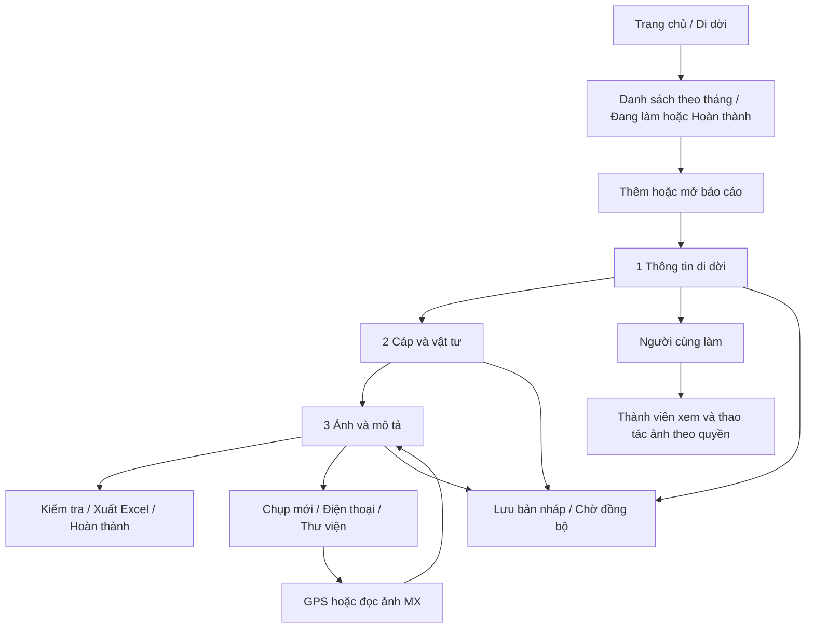

# Di dời theo Android 4.1.4

Đặc tả cho GitHub Copilot/người triển khai thiết kế lại **Di dời** trên HP Telecom Staging theo Android native **4.1.4, build 136**. Module API là `relocation`, tên loại local là `Di dời`. Giữ dữ liệu, tính toán và hành vi ảnh của bản nền khi thay giao diện.

Đọc cùng [dữ liệu và API](DI-DOI-DATA-API.md), [nghiệm thu](DI-DOI-CHECKLIST.md), [mã tham chiếu](reference/4.1.4/relocation/README.md). Phần nhóm tự tạo và kết nối staging cần triển khai riêng; các màn hình dưới đây là hành vi đọc từ mã 4.1.4.

## Luồng chính

Di dời có **3 bước**. Kiểm tra và xuất nằm cuối bước Ảnh; không thêm bước thứ tư chỉ vì Sự cố dùng bốn bước. Người cùng làm có giao diện tập trung vào ảnh, không có toàn bộ biểu mẫu của người lập.

## 1. Danh sách báo cáo

Nguồn dùng chung đã có: [MainActivity](reference/4.1.4/patrol/MainActivity.kt), [WorkModel](reference/4.1.4/patrol/WorkModel.kt).

- Tài khoản phải có module `relocation` hoặc admin theo hợp đồng bản chính.
- **Thêm Di dời**: nhập tên báo cáo/tuyến, không để trống, tối đa 160 ký tự trong hộp tên. Điện thoại được tạo báo cáo Di dời.
- Bộ chọn **Tháng** lấy tháng từ `report.date` tức ngày thực hiện; có Tất cả tháng và Chưa rõ tháng. Không lấy tháng giao tuyến của Tuần tuyến.
- Mặc định Đang làm; nút Đã hoàn thành chuyển sang danh sách tương ứng. Khi tất cả tháng được chọn, báo cáo chia nhóm tháng mới trước.
- Chạm mở báo cáo; nhấn giữ báo cáo thuộc quyền quản lý có Chọn nhiều, Sao chép, Sửa tên, Xóa. Người cùng làm không được dùng các thao tác quản lý báo cáo của người lập.
- Chọn nhiều có chọn/bỏ chọn tất cả, xuất Excel thành ZIP, xóa theo quyền và hủy chọn. Luồng chuẩn Di dời không có nút xuất KMZ.
- Báo cáo cùng làm có nhãn Cùng làm. Không coi mọi thành viên cùng Team là đã được thêm vào từng báo cáo.
- Sửa tên cố gắng cập nhật chữ trên ảnh khi có ảnh gốc/metadata chữ; ảnh cũ thiếu thông tin phải hiện số ảnh chưa cập nhật. Xóa có xác nhận phạm vi dữ liệu local.

## 2. Bước Thông tin di dời

Nguồn: [IncidentActivity.information](reference/4.1.4/relocation/source/IncidentActivity.kt).

| Thành phần | Hành vi |
| --- | --- |
| Tự nhập địa điểm / Lấy theo định vị | Hai chế độ, địa điểm vẫn có thể sửa bằng tay. |
| Địa điểm di dời | Chuỗi địa chỉ hoặc tọa độ; không thay nội dung mới gõ bằng kết quả GPS đến muộn. |
| Người lập báo cáo | Hiển thị tên tài khoản; báo cáo chia sẻ giữ người lập gốc. |
| Ngày thực hiện | Chọn lịch, nút Hôm nay; định dạng dd/MM/yyyy. |
| Nguyên nhân | Điện lực yêu cầu; Dân yêu cầu di dời; Khác để nhập tự do. |
| Nội dung di dời | Nội dung công việc người dùng nhập. |
| Người cùng làm | Chọn nhiều thành viên theo danh sách server cho phép. |
| Điều hướng | Lưu bản nháp, Tiếp tục, chuyển bước, Quay lại. |

Di dời không hiển thị khoảng cách đến trạm, thời gian nhận sự cố hay thời gian khôi phục dịch vụ trong biểu mẫu này.

Lấy địa điểm GPS chờ tối đa 30 giây, bỏ bản cập nhật cũ hơn 30 giây, kết thúc sớm nếu sai số ≤20 m. Kết quả ghi tọa độ trước, bổ sung địa chỉ nếu tìm được. Nếu người dùng sửa địa điểm trong lúc chờ, giữ nội dung người dùng. Có Hủy lấy định vị/Lấy lại và thông báo thiếu quyền hoặc GPS tắt.

## 3. Bước Cáp và vật tư

Nguồn: [IncidentReport và IncidentRules](reference/4.1.4/relocation/source/IncidentReport.kt).

### Loại cáp dùng chung

- Chủng loại: **2FO, 4FO, 6FO, 8FO, 12FO, 24FO, 48FO, 96FO**.
- Khoảng vượt: **KV100, KV200, KV300, KV500**.
- Di dời dùng một lựa chọn chủng loại cáp chung cho cáp thu hồi và cáp mới. Giữ `cable` và `recoveryCable` nhất quán khi người dùng chọn.

### Hai lựa chọn độc lập

| Lựa chọn | Trường và cách tính |
| --- | --- |
| Có thu hồi, kéo lại cáp | Nhập số mét thu hồi vào recoveryLength. Bản mới tạo ban đầu có recovery=true. |
| Có kéo cáp mới | Nhập Đầu số cáp mới 1 và 2. Số mét = trị tuyệt đối hiệu hai đầu số. |
| Cả hai | Cho bật đồng thời; giữ riêng số mét thu hồi và số mét cáp mới. |

Ví dụ: thu hồi 50 m cáp 12FO, đầu số mới 3067 và 2917 → **150 m cáp mới**. Nội dung tổng hợp có “Thu hồi kéo lại 50m 12FO” cùng nội dung người dùng; bảng vật tư tính **150m cáp 12FO** và vật tư mới, không cộng 50 m thu hồi thành cáp mới.

Bản 4.1.4 có nhãn giải thích tổng chiều dài gồm hai phần, nhưng không có ô nhập tổng thứ ba trong bước này. Tắt cáp mới không xóa số mét thu hồi. Nhập lại đầu số mới sẽ bỏ giá trị `relocationLength` cũ dùng để tương thích.

Số chấp nhận dấu phẩy hoặc chấm thập phân, không nhận âm/NaN/ký tự lạ. Khi thiếu một đầu số, hiển thị “—” và cảnh báo chiều dài; không coi là 0 m hợp lệ.

### Danh sách vật tư

Loại có sẵn: Măng xông, Néo, Treo, Ty, Kẹp, Gông dự phòng, D12, Đai Inox, Biển báo, Vật tư khác.

- Mỗi dòng: loại/tên, số lượng, đơn vị, ghi chú; Bỏ vật tư có xác nhận.
- Măng xông chọn loại theo danh sách FO; Vật tư khác yêu cầu tên cụ thể.
- Đơn vị gợi ý: Néo/Treo = bộ; Đai Inox = m; D12 để trống cho nhập; các loại còn lại = cái.
- Vật tư vẫn dùng được khi chỉ thu hồi cáp. Không ẩn/xóa vật tư theo quy tắc riêng của Sự cố.
- Thêm nhiều dòng được; không tự gộp dòng trùng tên hoặc mất ghi chú.
- Đọc dữ liệu cũ chuyển “Thẻ tên” thành “Biển báo”.

### Chuyển đổi dữ liệu cũ

`splitRelocation` đánh dấu đã tách hai phần cáp. Với báo cáo cũ đang thu hồi, chuyển relocationLength sang recoveryLength, giữ loại cáp, xóa đầu số cũ và không tự bật cáp mới. Với báo cáo cũ không thu hồi và có số mét, giữ số mét cũ cho đến khi nhập hai đầu số. Chạy chuyển đổi nhiều lần không được mất dữ liệu.

## 4. Bước Ảnh và mô tả

Nguồn: [IncidentActivity.photos](reference/4.1.4/relocation/source/IncidentActivity.kt).

Bản khởi tạo có Trước di dời, Trong thi công, Sau hoàn thành, Vật tư, Măng xông (MX). Khi người lập mở báo cáo, `prepare` bổ sung **Đầu số cáp** và **Kết quả đo kiểm** nếu thiếu: giao diện đầy đủ có **7 nhóm**.

- “Trong thi công” hiển thị nhãn **Hình ảnh thi công**.
- Giữ thứ tự theo `IncidentRules.ordered`; nhóm thi công được đặt trước Kết quả đo kiểm. Với báo cáo mới sau prepare: Trước di dời → Sau hoàn thành → Vật tư → MX → Đầu số cáp → Hình ảnh thi công → Kết quả đo kiểm. Không lấy danh sách 5 nhóm ở constructor hoặc test cũ làm toàn bộ giao diện.
- Mỗi nhóm có tên, số ảnh, mũi tên thu gọn/mở rộng. Mặc định thu gọn khi mở báo cáo.
- Hai ảnh mỗi hàng; mỗi ảnh có mô tả riêng và mỗi hàng có mô tả chung. Ảnh lẻ cuối hàng vẫn hiển thị/xuất đúng.
- Người lập sửa caption và mô tả hàng. Chạm ảnh xem lớn; nhấn giữ có Xem ảnh, Tải xuống, Xóa khỏi báo cáo theo quyền.
- Nguồn ảnh: Chụp mới, Chọn từ điện thoại (cho chọn nhiều), Chọn từ thư viện server, hoặc ảnh đã lưu trước đây nếu có.
- Không có giới hạn số ảnh/nhóm được đặt trong luồng biểu mẫu; phải hỗ trợ cuộn danh sách dài. Một batch thêm ảnh lỗi giữa chừng phải nói rõ đã thêm bao nhiêu.
- Sau thêm ảnh thường nhóm thu gọn; sau thêm MX nhóm mở để kiểm tra tọa độ.

### Camera và ảnh chờ GPS

Camera dùng thành phần native chung; giữ tuyến, ngày, tọa độ và ghi chú trên ảnh. Sau chụp có trạng thái pending lưu trước khi đưa ảnh vào nhóm. Nếu chưa xong có **Tiếp tục ảnh chờ GPS / Hủy ảnh chờ GPS**.

Ảnh pending đã viết GPS thì tiếp tục nhập, không bắt lấy GPS hiện tại lần nữa. Ảnh pending chưa ghi GPS yêu cầu đứng đúng vị trí chụp, lấy lại GPS; sai số >50 m hoặc không rõ thì hỏi trước khi lưu. Từ chối quyền hoặc đóng màn hình vẫn giữ ảnh chờ. Không cho hoàn thành khi còn pendingPhoto.

### MX và sửa lỗi của 4.1.4

- Dùng GPS từ metadata/hint của đúng ảnh khi hợp lệ; nếu chưa có thì đọc ảnh bằng MxLocalReader trước khi lưu.
- Không lấy ghi chú nhóm hoặc GPS hiện tại làm bằng chứng tọa độ cho ảnh cũ.
- Giữ đọc EXIF/OCR, vùng cắt từ ảnh gốc, kiểm tra kết quả và cache theo tài khoản/nội dung ảnh của bản 136.
- JPEG/PNG MX trong giới hạn được giữ dữ liệu gốc; khi cần chuyển định dạng/giảm kích thước, giữ GPS có sẵn và giới hạn tải 10 MB.
- Tọa độ điền **một lần vào mô tả hàng ảnh**; giữ ghi chú thủ công. Caption ảnh không cần lặp lại tọa độ tự sinh.
- Hiện tọa độ/nguồn hoặc Chưa đọc/Chưa đọc rõ/Lỗi; người lập có **Đọc và điền tọa độ MX** khi còn ảnh cần xử lý.
- Di dời vẫn có MX nhưng không điền hai ô `closureLocation`/`closureLocation2` của bảng tổng hợp Sự cố: hàm tương ứng bỏ qua relocation.
- Kết quả server có thể đến muộn mà revision không đổi; phải giữ cơ chế nhận lại và không thay dữ liệu khi người dùng đang mở sửa.

### Xóa ảnh

Xác nhận rõ xóa khỏi báo cáo và đồng bộ đến người cùng làm. Ảnh thư viện gốc được giữ. Xóa một ảnh phải sắp lại cặp ảnh và mô tả hàng; giữ ghi chú thủ công, chỉ bỏ tọa độ tự sinh thuộc ảnh đã xóa khi không còn ảnh khác dùng nó. Xóa tất cả vẫn giữ mô tả thủ công. Lỗi lưu phải khôi phục nhóm ảnh và trạng thái trước đó.

## 5. Người cùng làm

Nguồn: [SharedReports](reference/4.1.4/relocation/source/SharedReports.kt), [PhotoMutationDelta](reference/4.1.4/relocation/source/PhotoMutationDelta.kt).

Người lập đồng bộ báo cáo trước, lấy danh sách thành viên/candidates và revision, chọn nhiều rồi Lưu/Hủy. Server quyết định ai có thể thêm; không dùng danh sách tài khoản tự dựng.

Người cùng làm thấy tên báo cáo/người lập, các nhóm ảnh, lưu ảnh trên máy và xuất Excel. Không sửa thông tin chung/cáp/vật tư hoặc tự hoàn thành báo cáo. Việc thêm, sửa caption, xóa ảnh phải theo quyền và trạng thái đồng bộ thực tế; không suy ra “chỉ được xóa ảnh mình chụp” hoặc “được xóa mọi ảnh” từ role đơn lẻ.

Khi báo cáo hoàn thành hoặc bị thu hồi quyền, khóa thao tác gửi/thêm tương ứng và giữ ảnh chưa gửi. Gửi thay đổi ảnh bằng delta chuyên biệt; không gửi toàn bộ bản báo cáo cũ đè dữ liệu người lập.

## 6. Lưu hoàn thành và kiểm tra

- Trường nhập tự lưu bản nháp; có nút Lưu bản nháp. Hiện Đang lưu, Đã lưu bản nháp, lỗi lưu và thử lại.
- Quay lại chờ lưu xong rồi đóng; không bỏ thay đổi đang nhập. Đổi tài khoản/phiên phải được kiểm tra trong thao tác bất đồng bộ.
- Sửa dữ liệu của người lập đặt completed=false. Hoàn thành ở cuối bước 3 hỏi xác nhận và yêu cầu xử lý ảnh pending trước.
- Cảnh báo: thiếu địa điểm/người thực hiện/ngày/nội dung; ngày sai; cáp thu hồi hoặc cáp mới không hợp lệ; vật tư thiếu; nhóm ảnh trống; ảnh chờ GPS.
- Nguyên nhân di dời và khoảng vượt không phải điều kiện bắt buộc trong hàm warnings hiện tại.
- Cảnh báo không tự khóa mọi thao tác: xuất có **Quay lại bổ sung / Vẫn xuất file**. Nút Hoàn thành hiện chỉ chặn pendingPhoto, không kiểm tra toàn bộ warnings. Nếu tăng mức kiểm tra ở bản mới, nêu rõ thay đổi riêng.

Hoàn thành, đã lưu local và đồng bộ thành công là ba trạng thái khác nhau. Di dời đã hoàn thành thuộc **tháng trước** có thể được gỡ local khi đã xác minh chủ sở hữu, dữ liệu/ảnh/revision/receipt trùng server, không pending và không đang sửa. Không áp dụng quy tắc gỡ ngay của Tuần tuyến cho Di dời; dữ liệu giữ trên server.

## 7. Excel

Nguồn: `IncidentExport` trong [IncidentReport.kt](reference/4.1.4/relocation/source/IncidentReport.kt).

- Tiêu đề BÁO CÁO DI DỜI + tên; địa điểm, người thực hiện, ngày thực hiện.
- Nguyên nhân chỉ có khi đã nhập; nội dung gồm phần thu hồi kéo lại và nội dung thủ công; vật tư chỉ tính cáp mới và vật tư mới sau chuyển đổi.
- Không thêm thời gian nhận sự cố, khôi phục hoặc tổng phút xử lý vào mẫu Di dời.
- Xuất các nhóm có ảnh; Kết quả đo kiểm luôn ở cuối.
- Mỗi hàng ảnh trái/phải, phần mô tả ở giữa; lấy mô tả hàng cùng caption, bỏ dòng trùng trong phần xuất. Nhúng ảnh thật, giữ tỉ lệ ảnh và hỗ trợ JPEG/PNG theo nội dung.
- File thiếu/hỏng phải báo lỗi, không báo thành công chỉ vì tạo được tên .xlsx.
- Nút Xuất báo cáo Excel gọn mở bộ chia sẻ/lưu của Android. Xuất nhiều báo cáo từ danh sách tạo ZIP, tên trùng không đè file.
- Xuất thành công không chứng minh báo cáo đã đồng bộ.

## 8. Yêu cầu giao diện staging

Giữ ba bước và đường vào mọi chức năng. Làm rõ nhãn thu hồi/cáp mới, số mét tính ra, các nhóm ảnh thu gọn bên phải, trạng thái đọc MX và bản nháp. Kiểm tra chữ có dấu, light/dark, tên dài, bàn phím và cỡ chữ lớn.

Team/Đội theo nhóm đã tạo/tham gia là phần thêm cho staging: cần group ID, API và quyền riêng. Giữ tên nhóm do người tạo nhập; không thay bằng slug. Mọi request phải thuộc staging và dữ liệu tài khoản staging.
