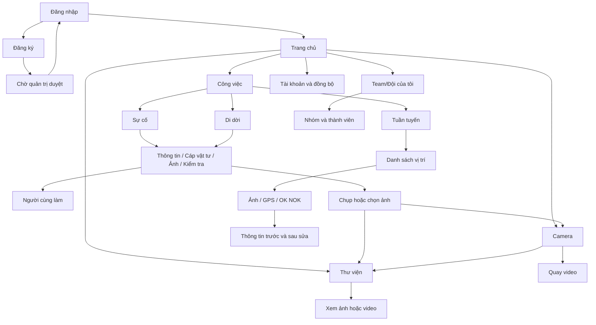

# Cấu trúc giao diện HP Telecom Staging

Thiết kế lại giao diện ứng dụng Android HP Telecom cho môi trường staging, lấy chức năng của APK native **4.1.4, build 136** làm nền. Bản staging cần cài song song với ứng dụng server chính và thể hiện rõ tên **HP Telecom Staging**.

Đây là bộ cấu trúc và yêu cầu thiết kế. Chưa phải giao diện đã triển khai hoặc APK staging đã kết nối thành công.

## Tài liệu bàn giao

- [Danh sách màn hình và thành phần](SCREENS.md): nội dung, nút, trạng thái và luồng sử dụng.
- [Mã nguồn và kết nối staging](INTEGRATION.md): nơi xử lý từng chức năng, phần cần giữ và phần còn phải tích hợp.
- [Yêu cầu dành cho GitHub Copilot hoặc người thiết kế](DESIGN-TASK.md): công việc thiết kế lại có thể giao trực tiếp.

## Tuần tuyến theo bản Android 4.1.4

- [Đặc tả đầy đủ màn hình và nghiệp vụ](TUAN-TUYEN-4.1.4.md).
- [Trường dữ liệu và hợp đồng API](TUAN-TUYEN-DATA-API.md).
- [Kịch bản kiểm tra và giao việc cho Copilot](TUAN-TUYEN-CHECKLIST.md).
- [Mã và test tham chiếu từ bản 4.1.4](reference/4.1.4/README.md).

Bộ tham chiếu có phần mã Tuần tuyến và các đoạn đồng bộ liên quan. Đây chưa phải dự án Android đầy đủ để build APK.

## Phạm vi

Giữ đầy đủ Sự cố, Tuần tuyến, Di dời, Camera, Thư viện, bản nháp, xuất báo cáo và đồng bộ của APK native. Bổ sung thiết kế Team/Đội theo mô hình nhóm người dùng tự tạo của staging.

| Phần | Hiện trạng |
| --- | --- |
| APK server chính | Native Kotlin/Android Views, bản 4.1.4 (136). |
| Đọc tọa độ MX | Có đọc ảnh gốc và nhận lại kết quả từ server khi phiên bản báo cáo không đổi. Phải giữ khi đổi giao diện. |
| Giao diện web staging | Công việc riêng tại [PR #2](https://github.com/trieutiendl/hptelecom/pull/2). |
| Android cho staging | Cần thiết kế lại và tích hợp API; chưa xác nhận chạy được. |
| Team/Đội trên Android | Màn hình cần bổ sung; không trình bày như chức năng đã có trong APK 136. |

## Sơ đồ điều hướng đề xuất

Thanh điều hướng dưới gồm **Trang chủ · Công việc · Thư viện · Tài khoản**. Camera là hành động nổi bật từ Trang chủ và Thư viện. Đây là cách tổ chức đề xuất cho thiết kế mới; APK hiện tại dùng các ô chức năng trên trang chủ.

## Nguyên tắc thiết kế

- Tiếng Việt rõ ràng; giữ dấu và khoảng trắng trong tên nhóm do người tạo nhập.
- Nền và chữ tương phản rõ ở cả giao diện sáng và tối. Chữ chính từ 16sp, vùng chạm chính từ 48dp; kiểm tra thêm khi người dùng tăng cỡ chữ.
- Mỗi màn hình có một hành động chính dễ thấy. Các tác vụ phụ gom vào menu có nhãn dễ hiểu.
- Hiện “Đã lưu trên máy”, “Chờ đồng bộ”, “Đang gửi”, “Đã đồng bộ” đúng trạng thái thực. Lưu trên máy không đồng nghĩa đã gửi server.
- Biểu tượng thu gọn/mở rộng đặt bên phải tiêu đề; thu gọn được toàn bộ nhóm ảnh hoặc danh sách thành viên.
- Ô chọn nhóm tìm được tên có dấu/không dấu, chỉ lấy nhóm tài khoản đã tạo hoặc tham gia. Nhóm trùng tên phân biệt bằng đường dẫn hoặc chủ nhóm.
- Bộ lọc báo cáo theo tháng. Dữ liệu trống hiển thị trạng thái trống; lỗi kết nối có nút thử lại.
- Mọi mẫu thiết kế dùng dữ liệu giả và gắn nhãn “Minh họa”. Không dùng ảnh báo cáo, thông tin đăng nhập hoặc dữ liệu khách hàng thật.

## Kết quả cần bàn giao

1. Bộ màn hình cùng phong cách và prototype chuyển màn hình.
2. Thành phần dùng chung: thanh điều hướng, biểu mẫu, thẻ công việc, chọn nhóm/tháng, nhóm ảnh thu gọn, trạng thái đồng bộ và hộp thoại xác nhận.
3. Thiết kế cho màn hình nhỏ, bàn phím mở, dữ liệu dài, danh sách lớn, offline và thiếu quyền Camera/GPS.
4. Danh sách chức năng đã có, chức năng mới và phần phụ thuộc API staging.
5. Sau khi có mã native nền trong nhánh làm việc: triển khai giao diện Android và kiểm thử chức năng trước khi đóng gói APK staging.
