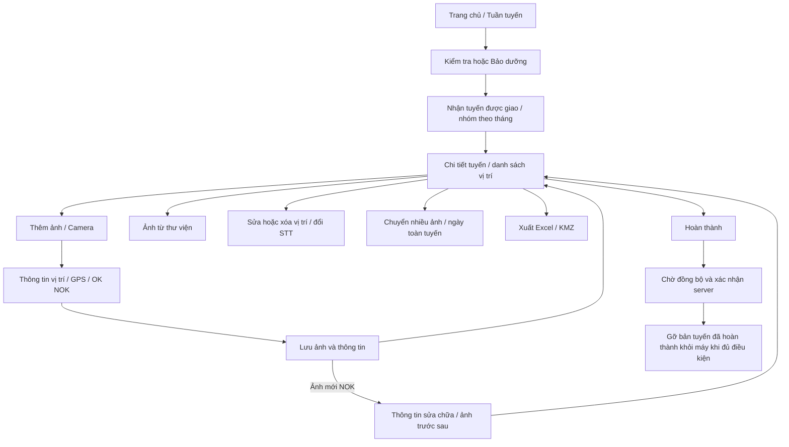

# Tuần tuyến theo Android 4.1.4

Đặc tả để thiết kế lại **Tuần tuyến** của HP Telecom Staging, giữ luồng và dữ liệu của Android **4.1.4, build 136**. Trong mã, tên lưu trữ là `Tuyến cáp`, module là `cable`; nhãn người dùng là **Tuần tuyến**. Không đổi các giá trị lưu trữ khi đổi giao diện.

Đọc cùng [dữ liệu và API](TUAN-TUYEN-DATA-API.md), [kịch bản nghiệm thu](TUAN-TUYEN-CHECKLIST.md) và [mã tham chiếu 4.1.4](reference/4.1.4/README.md). Các mô tả “4.1.4” dưới đây dựa trên mã nguồn; mục cuối ghi riêng phần thiết kế mới cho staging.

## Luồng tổng thể

Bản nháp, ảnh trên máy và trạng thái server là ba lớp riêng. Nút Hoàn thành không được làm người dùng hiểu rằng dữ liệu đã gửi xong.

## 1. Danh sách tuyến

Nguồn: [MainActivity](reference/4.1.4/patrol/MainActivity.kt), [WorkModel](reference/4.1.4/patrol/WorkModel.kt).

- Chỉ vào được khi tài khoản có module `cable` hoặc là admin theo hợp đồng của bản chính.
- Tuyến do quản trị tạo và giao trên server. Điện thoại có **Nhận tuyến được giao**, không có tạo, sao chép hoặc sửa tên tuyến cáp từ menu danh sách.
- Bộ chọn loại: **Kiểm tra** (`inspection`, mặc định), **Bảo dưỡng** (`maintenance`); thêm **Chưa phân loại** nếu tồn tại dữ liệu loại khác.
- Tuyến được chia nhóm tháng mới trước, lấy tháng từ thời điểm **giao tuyến** của server theo múi giờ Việt Nam. Thiếu ngày giao thì ở **Chưa rõ tháng**.
- Bản 4.1.4 nhóm tuyến theo tháng; nút lọc tháng riêng trong cùng Activity hiện dành cho Sự cố/Di dời. Bộ lọc tháng cho Tuần tuyến là phần có thể bổ sung ở staging.
- Thẻ tuyến hiện tên; dấu ✓ khi có bộ ảnh và tất cả bộ ảnh đều hoàn thành. Có trạng thái rỗng; dữ liệu trên máy vẫn còn khi nhận tuyến gặp lỗi.
- Chạm tuyến mở bộ ảnh hiện hành. Nếu có các bộ ảnh cũ, giữ lối vào **Các bộ ảnh đã lưu trước đây**.
- Nhấn giữ tuyến: **Chọn nhiều**, **Xóa**. Chế độ nhiều tuyến có chọn/bỏ chọn tất cả, xuất Excel, KMZ, Excel + KMZ, xóa và hủy chọn.
- Xóa phải có xác nhận nêu cả ảnh, thông tin và bản nháp. Thao tác xóa dữ liệu local không được thiết kế như nút hủy giao việc hoặc xóa công việc server.

Thiết kế mới cần hiển thị rõ loại công việc, tháng giao, số vị trí, trạng thái và ghi chú giao việc. Có thể dùng menu ba chấm thay cho thao tác chỉ nhấn giữ, miễn vẫn đủ hành động.

## 2. Chi tiết tuyến và vị trí

- Tiêu đề tuyến, ghi chú quản trị giao, trạng thái **Đang thực hiện / Đã hoàn thành**.
- Danh sách theo STT, mỗi mục gồm STT, tên vị trí, latitude/longitude và ghi chú. Chạm xem ảnh phóng to.
- **Thêm ảnh** mở camera qua bản nháp. **Thêm ảnh từ thư viện** chọn ảnh server có GPS. Hai nút thêm ẩn khi bộ ảnh hoàn thành.
- Nếu có bản nháp, hiện **Tiếp tục bản nháp**. Bản nháp đang thuộc tuyến khác phải được mở xử lý trước khi chụp tuyến hiện tại.
- **Hoàn thành / Mở lại**, **Xuất / Chuyển ảnh**, **Ngày tháng toàn tuyến** phải còn đường vào rõ ràng.
- Nhấn giữ vị trí mở **Xóa**, **Sửa ảnh / STT**, **Sửa thông tin · OK / NOK**, **Tải ảnh xuống**.
- Khi đang chọn nhiều ảnh, chạm chỉ chọn/bỏ chọn; có số đã chọn, chọn tất cả, chuyển tuyến khác và hủy chọn. Quay lại thoát chế độ chọn trước khi rời trang.

## 3. Chụp ảnh và nhập vị trí

Nguồn: [CaptureActivity](reference/4.1.4/patrol/CaptureActivity.kt), [Draft](reference/4.1.4/patrol/Draft.kt), [Rules](reference/4.1.4/patrol/Rules.kt).

| Trường | Hành vi 4.1.4 cần giữ |
| --- | --- |
| Tuyến | Lấy từ tuyến đang mở, không nhập một tên tuyến khác trong camera. |
| STT | Số nguyên dương. Gợi ý số dương nhỏ nhất chưa có; cho sửa/chèn. |
| Tên vị trí | Bắt buộc; trường trong hộp thông tin camera giới hạn 120 ký tự. |
| Ghi chú / Mô tả báo cáo | Bắt buộc lúc lưu; chuyển chữ hoa tiếng Việt. MX hoặc DP được dùng đánh dấu điểm KMZ. |
| Đánh giá | OK — Đạt / NOK — Chưa đạt. Camera yêu cầu chọn trước khi chụp. |
| Kiến nghị / Giải pháp | Nhập trong hộp Thông tin vị trí; không tự biến thành trường bắt buộc nếu muốn giữ hành vi 4.1.4. |
| GPS | Latitude, longitude, sai số và thời điểm lấy; không dùng tọa độ giả để vượt lỗi. |
| Địa chỉ GPS | Tìm địa chỉ từ tọa độ. Không lấy được địa chỉ vẫn giữ GPS. |
| Ngày ảnh | Hiện/ẩn ngày; ngày được giữ cùng ảnh. |
| Màu chữ | Trắng, Vàng, Đen, Đỏ, Xanh theo tùy chọn camera. |

Camera có xem trước, chụp, zoom và điều khiển ánh sáng theo khả năng thiết bị; giữ nút **Thông tin vị trí** và **Tùy chọn chụp ảnh**. Sau khi chụp, trở về màn hình kiểm tra thông tin với ảnh xem trước, **Chụp lại**, **Lưu ảnh / Hoàn thành thông tin**, **Giữ bản nháp và quay lại**, **Xóa bản nháp**.

### Quy tắc GPS và lưu

- Camera bỏ bản cập nhật GPS cũ quá 30 giây; trước khi chụp yêu cầu điểm GPS không cũ quá 120 giây.
- Sai số trên 50 m hoặc thiếu thông tin sai số: hỏi **Chờ thêm / Vẫn chụp**.
- Màn hình chỉnh thông tin có **Lấy GPS tại vị trí hiện tại**, **Mở cài đặt Vị trí**. Lấy GPS ở màn hình này chờ tối đa 60 giây, dừng khi sai số ≤20 m; lúc lưu sai số >50 m hỏi xác nhận.
- Chưa có quyền chính xác, GPS tắt, không có thiết bị GPS, hết thời gian: giải thích đúng trạng thái và giữ bản nháp.
- Lưu yêu cầu STT, tên, ghi chú, GPS hợp lệ và file ảnh gốc tồn tại; không đang chụp dở. Kiểm tra kinh độ/vĩ độ là số hữu hạn trong phạm vi.
- `Rules.validate` chấp nhận 0/0 về mặt phạm vi, còn đường nhập ảnh thư viện từ chối 0/0. Không diễn giải 0/0 thiếu metadata thành vị trí đã lấy thành công.
- Ảnh gốc và ảnh có chữ phải được giữ riêng. Chữ gồm tuyến, STT/vị trí, ngày nếu bật, tọa độ và ghi chú; ảnh xuất có EXIF GPS và metadata giữ tiếng Việt.
- Lưu trên máy thành công rồi mới dọn bản nháp và xếp đồng bộ. Lỗi lưu album hoặc xếp thư viện server được báo riêng; không nói ảnh báo cáo đã mất khi ảnh vẫn lưu.
- Ảnh mới có đánh giá **NOK**: sau khi lưu tự mở màn hình thông tin sửa chữa. Sửa đánh giá của ảnh cũ không bắt chụp lại.

## 4. OK NOK và ảnh trước sau sửa

Nguồn: [CableRepairActivity](reference/4.1.4/patrol/CableRepairActivity.kt).

Màn hình có tên vị trí, **Xem ảnh vị trí đã chụp**, **Địa chỉ GPS**, **Mô tả**, **Phương án / Kiến nghị sửa**, OK/NOK và **Lưu thông tin**.

Mỗi phần **Trước sửa / Sau sửa** có xem ảnh nếu đã có, chụp mới, chọn ảnh trên máy và chọn từ thư viện server. Chọn từ máy giới hạn 10 MB trong luồng hiện tại.

- Đổi OK/NOK và lưu thông tin giữ ảnh trước/sau cũ.
- Thêm/thay ảnh trước hoặc sau đặt đánh giá về **NOK** trong mã 4.1.4. Không tự coi có ảnh sau là hoàn thành sửa hay tự chuyển OK.
- Ảnh lấy từ thư viện được sao chép thành tệp thuộc báo cáo; thay/xóa ảnh báo cáo không xóa ảnh gốc Camera/NAS.
- Thông tin chi tiết gắn với `points[STT]`; đổi STT hoặc chuyển tuyến phải mang theo thông tin và các ảnh này.
- Lưu phần chi tiết không tự đổi trạng thái hoàn thành của tuyến trong hàm hiện tại. Nếu thay quy tắc này ở thiết kế mới phải nêu thành thay đổi riêng.

## 5. STT và sửa xóa ảnh

Nguồn: [RouteSequence](reference/4.1.4/patrol/RouteSequence.kt), [WorkModel.save/delete](reference/4.1.4/patrol/WorkModel.kt).

| Tình huống | Kết quả |
| --- | --- |
| Đang có 1, 2, 3; thêm mới tại 2 | Ảnh cũ 2→3, 3→4; ảnh mới ở 2. |
| Chuyển STT 7 về 2 | Các ảnh 2..6 dịch lên một số. |
| Chuyển STT 2 đến 7 | Các ảnh 3..7 dịch xuống một số. |
| Xóa STT 2 trong 1, 2, 3 | Giữ 1, 3; có thể dùng lại số 2. Lần thêm tại 2 vẫn áp dụng quy tắc chèn của bản 4.1.4. |
| Đổi số làm ảnh vượt giới hạn số nguyên | Báo lỗi; không lưu nửa chừng. |

Đổi số cập nhật cả chữ trên ảnh và khóa thông tin `points`. Nếu một ảnh cần đổi số thiếu ảnh gốc, dừng trước khi đổi dữ liệu. Dùng giao dịch để tránh trùng STT và không ghi đè vị trí khi danh sách vừa thay đổi.

Sửa ảnh đã lưu sẽ mở lại bộ ảnh hoàn thành. Xóa vị trí cũng mở lại, bỏ metadata của vị trí và xử lý tệp liên quan. Xóa bản nháp đang sửa ảnh không xóa ảnh đã lưu. Không xóa vị trí khi chính ảnh đó đang có bản nháp chỉnh sửa.

## 6. Chuyển ảnh sang tuyến khác

Nguồn: [RoutePhotoMove](reference/4.1.4/patrol/RoutePhotoMove.kt), [RouteMoveNumbers](reference/4.1.4/patrol/RouteMoveNumbers.kt).

1. Chọn một hoặc nhiều ảnh từ tuyến nguồn.
2. Chọn tuyến đích đã nhận trên máy, khác tuyến hiện tại.
3. Xác nhận rõ: bỏ ảnh khỏi tuyến nguồn, đổi tên tuyến và STT trên ảnh, mở lại hai tuyến.
4. Chặn nếu nguồn hoặc đích có bản nháp đang sửa.
5. Giữ thứ tự ảnh được chọn; cấp số tiếp sau STT lớn nhất đang có ở tuyến đích, tính cả metadata điểm. Không lấp lỗ trống ở tuyến đích.
6. Mang theo ảnh gốc, tọa độ, ghi chú, thời gian, người chụp và metadata trước/sau; vẽ lại chữ theo tuyến đích.
7. Thiếu ảnh gốc hoặc dữ liệu vừa đổi: không chuyển một phần. Thành công thì cả hai bộ ảnh liên quan về đang thực hiện và chờ đồng bộ.

## 7. Ảnh từ thư viện và ngày toàn tuyến

**Ảnh từ thư viện** chỉ thêm vào tuyến đang mở, chưa hoàn thành, tài khoản có quyền Tuần tuyến, không có bản nháp cùng bộ ảnh. Cần file thuộc tài khoản hiện tại và GPS hợp lệ, khác 0/0. Dùng bản sao, giữ người chụp/ngày/ghi chú; không lấy GPS hiện tại thay cho GPS của ảnh cũ. Luồng này không bắt chọn OK/NOK ngay; có thể vào Sửa thông tin sau.

Ảnh nhập thư viện hiện có thể dùng cùng đường dẫn cho `path` và `originalPath`; vì vậy đổi ngày, chuyển tuyến hoặc đổi STT cần vẽ lại ảnh có thể bị chặn do thiếu ảnh gốc. Thiết kế phải hiện lý do, không giả báo thành công.

**Ngày tháng toàn tuyến** gồm hiện ngày, ẩn ngày, đổi ngày bằng lịch và xác nhận. Áp dụng cho ảnh thuộc các bộ ảnh trong tuyến. Chặn khi có bản nháp cùng tuyến; kiểm tra đủ ảnh gốc trước khi xử lý. Đổi ngày cập nhật `capturedAt`, không chỉ bật/tắt chữ. Giữ GPS, STT và ghi chú. Không thay đổi một phần nếu một ảnh lỗi.

## 8. Hoàn thành đồng bộ và lưu trữ

Nguồn: [quy trình nhận tuyến](reference/4.1.4/excerpts/ServerSync.receiveCableTasks.kt.txt), [gửi báo cáo](reference/4.1.4/excerpts/ServerSync.uploadLocked.kt.txt), [CableArchiveCheck](reference/4.1.4/patrol/CableArchiveCheck.kt).

- Hoàn thành cần ít nhất một ảnh đã lưu và không còn bản nháp cùng bộ ảnh. Mở lại để thêm mới khi bộ ảnh vẫn còn trên máy.
- Hiện trạng thái lưu trên máy, chờ gửi, đang gửi, đồng bộ thành công, lỗi hoặc xung đột riêng với OK/NOK và hoàn thành.
- Server trả phiên bản mới hơn hoặc hai nơi sửa cùng dữ liệu: giữ dữ liệu local, không tự ghi đè để hết lỗi.
- Bản 4.1.4 có cơ chế **tự gỡ tuyến hoàn thành khỏi dữ liệu làm việc trên máy** sau khi xác nhận an toàn: local và server hoàn thành, cùng revision/chữ ký đã xác nhận, không còn pending hoặc yêu cầu tải lại, không đang mở sửa.
- Sau khi gỡ, tuyến đã hoàn thành không được tự nhận lại; khi server giao lại và đánh dấu chưa hoàn thành thì có thể nhận lại.
- Không thiết kế danh sách “Đã hoàn thành trên máy” như nơi chắc chắn giữ tất cả lịch sử. Nếu staging cần lịch sử đầy đủ, phải có API đọc lịch sử riêng.
- Tên tuyến đổi từ server phải được cập nhật trong tên bộ ảnh và chữ trên ảnh khi còn ảnh gốc; thiếu gốc thì báo ảnh chưa cập nhật.

## 9. Xuất Excel KMZ

Nguồn: [Exports](reference/4.1.4/patrol/Exports.kt), [CableHeader](reference/4.1.4/patrol/CableHeader.kt).

| Dạng | Hành vi phải giữ |
| --- | --- |
| Excel một tuyến | File .xlsx có ảnh nhúng, dữ liệu theo STT; không phụ thuộc cài Excel trên điện thoại. |
| Excel nền cũ | STT, Hình ảnh, Tên vị trí chụp hình, Latitude, Longitude, Ghi chú khi chưa có metadata cableWork. |
| Excel có cableWork | Tiêu đề báo cáo Kiểm tra/Bảo dưỡng, Team/Đội, Người thực hiện, Tên tuyến, Ngày tuần tuyến, Tổng chiều dài km. Cột STT, Địa chỉ, Tên vị trí, Hình ảnh, Mô tả, Kiến nghị/Giải pháp. |
| Vị trí NOK | Sheet đầu giữ mọi vị trí; thêm sheet **Chưa đạt - Sửa chữa** với ảnh trước/sau và kiến nghị. Thiếu ảnh trước thì dùng ảnh vị trí làm dự phòng, không tạo ảnh sau giả. |
| KMZ | ZIP chứa doc.kml. Đường nối toàn bộ điểm theo STT; từ hai điểm mới có LineString. Tọa độ KML theo thứ tự longitude,latitude,0. |
| Điểm đánh dấu KMZ | Điểm đầu, cuối và các điểm có MX hoặc DP trong ghi chú; một điểm duy nhất không nhân đôi. Ghi chú MX ở đây là nhãn bản đồ, không đồng nghĩa phải chạy OCR ảnh MX của Sự cố. |
| Nhiều tuyến | ZIP gồm Excel, KMZ hoặc cả hai theo lựa chọn; tên trùng được thêm số để không đè tệp. |
| Sau xuất | Cho lưu vào điện thoại hoặc chia sẻ bằng hệ thống Android. |

Xuất một tuyến chưa có ảnh báo lỗi. Xuất nhiều tuyến có cảnh báo tuyến trống và lựa chọn hủy/vẫn xuất; KMZ vẫn yêu cầu vị trí. Không thêm luật “thiếu ảnh xa thì không được xuất” từ một hàm cảnh báo không được gọi trong luồng xuất 4.1.4.

## 10. Phần bổ sung cho staging

Giữ chức năng phía trên; áp dụng giao diện sáng/tối đọc rõ chữ, vùng chạm dễ dùng, nhãn Staging, trạng thái rỗng/lỗi/offline, cỡ chữ lớn và bàn phím không che nút.

Nhóm tự tạo/tham gia, tìm Team/Đội có dấu/không dấu, lọc nhóm và nút lọc tháng cho Tuần tuyến là phần tích hợp mới. Dùng mã nhóm và giữ nguyên tên do người tạo nhập. Không đổi vai trò toàn hệ thống và vai trò trong nhóm thành một trường. Không tự thêm quyền tạo/giao tuyến trên Android nếu API staging chưa có hợp đồng đó.

Triển khai native phải bắt đầu từ nguồn Android đầy đủ. Thư mục tham chiếu chỉ cung cấp phần liên quan để đối chiếu; chưa phải dự án Android build độc lập.
